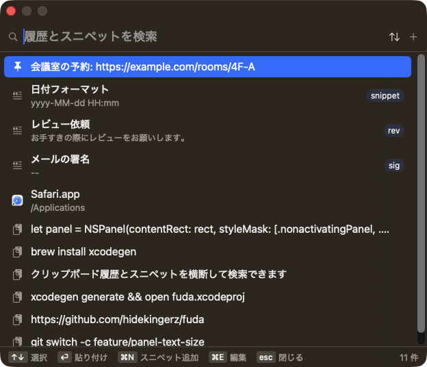
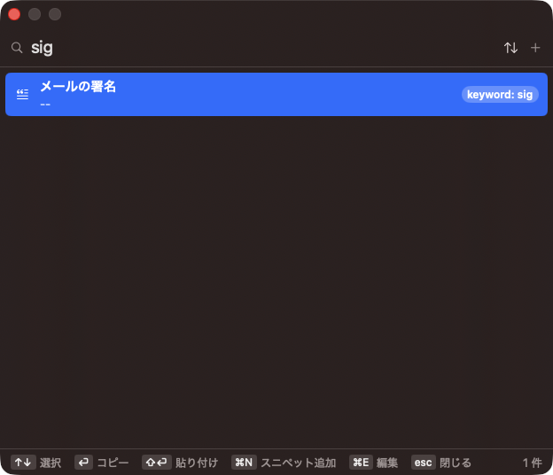

# fuda

macOS 用のクリップボード履歴＋スニペット管理アプリ。
ショートカットでパネルを呼び出し、履歴または登録済みスニペットを選んで元のアプリに貼り付ける。

<p align="center">
  
</p>

<p align="center">
  
</p>

## 必要なもの

- macOS 14 以降
- Xcode 16 以降
- [XcodeGen](https://github.com/yonaskolb/XcodeGen)（`brew install xcodegen`）

## ビルドと実行

```sh
xcodegen generate            # fuda.xcodeproj を生成（project.yml が正）
open fuda.xcodeproj          # Xcode で開いて ⌘R
```

コマンドラインの場合:

```sh
xcodebuild build -project fuda.xcodeproj -scheme fuda -configuration Debug -derivedDataPath build/DerivedData
open build/DerivedData/Build/Products/Debug/fuda.app
```

テスト:

```sh
xcodebuild test -project fuda.xcodeproj -scheme fuda -destination 'platform=macOS' -derivedDataPath build/DerivedData
```

## 使い方

| 操作 | キー |
|---|---|
| パネルを開く／閉じる | ⌘⇧V（設定で変更可） |
| 項目を選ぶ | ↑ / ↓（または ^P / ^N） |
| コピーのみ（既定） | ⏎ |
| 貼り付け（元のアプリへ ⌘V を送る） | ⇧⏎ |
| 閉じる | esc |
| スニペットを追加 | ⌘N またはパネル右上の「+」 |
| 選択中のスニペットを編集 | ⌘E または右クリック |
| 履歴のピン留め・削除 | 右クリック |

⏎ の動作は設定の「Enter の動作」で「コピーのみ」「貼り付け」から選べます。⇧⏎ はもう一方の動作です。
既定を「コピーのみ」にしているのは、改行を含む内容をターミナルに貼り付けると各行がそのまま実行されるなど、
意図しない場所への貼り付けを避けるためです。

他のツールから開くには `fuda://panel` を使います。`fuda://panel?q=sig` のように `q` を付けると検索欄にその文字列を入れた状態で開きます。`fuda://settings` で設定ウィンドウが開きます。

```sh
open "fuda://panel?q=sig"
```

初回起動時にアクセシビリティ権限のダイアログが出ます。「貼り付け」（元アプリへの ⌘V 送信）にだけ必要なので、
システム設定 > プライバシーとセキュリティ > アクセシビリティ で fuda を許可してください。
クリップボード履歴の取得自体は権限がなくても動きます。

## 構成

- `project.yml` — XcodeGen のプロジェクト定義
- `Sources/App` — エントリポイント、メニューバー、グローバルショートカット
- `Sources/Models` — SwiftData モデル（`ClipboardItem` / `Snippet`）とストア
- `Sources/Clipboard` — クリップボード監視と貼り付け
- `Sources/Panel` — NSPanel と SwiftUI のパネル UI
- `Sources/Settings` — 設定ウィンドウ
- `Tests` — ユニットテスト
- `docs/superpowers/specs` — 設計メモ

データは `~/Library/Application Support/fuda/fuda.store` に保存されます。
環境変数 `FUDA_STORE_PATH` で保存先を差し替えられます（デモやデバッグ用）。

## アイコン

アプリアイコンは Icon Composer 形式の `Sources/AppIcon.icon`（macOS 26 ではガラス表現、macOS 14/15 向けの icns は自動生成）、
メニューバーのアイコンは `Sources/Assets.xcassets/MenuBarIcon.imageset` です。絵柄は `scripts/render-icon.swift` で描いています。
形や線を変えたいときはスクリプトを直して次を実行し、出力を差し替えてください。

```sh
swift scripts/render-icon.swift /tmp/fuda-icon
cp /tmp/fuda-icon/tag-layer.png Sources/AppIcon.icon/Assets/tag.png
cp /tmp/fuda-icon/menubar.png /tmp/fuda-icon/menubar@2x.png Sources/Assets.xcassets/MenuBarIcon.imageset/
```

背景色や影は `Sources/AppIcon.icon/icon.json` で指定しています（Xcode の Icon Composer でも開けます）。

## スクリーンショットの撮り直し

README の画像はデモ用ストアで撮っています。実際の履歴を写さないよう、次の手順で再現できます。

```sh
TEST_RUNNER_FUDA_DEMO_STORE=/path/to/demo.store xcodebuild test -project fuda.xcodeproj -scheme fuda \
  -destination 'platform=macOS' -derivedDataPath build/DerivedData -only-testing:fudaTests/DemoStoreTests
FUDA_STORE_PATH=/path/to/demo.store build/DerivedData/Build/Products/Debug/fuda.app/Contents/MacOS/fuda &
open "fuda://panel"
```
